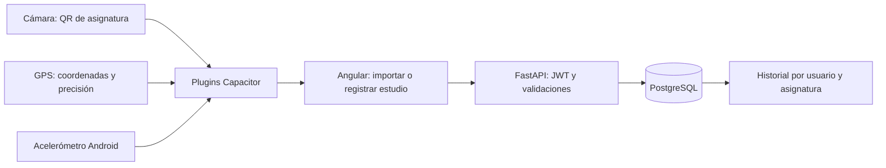

# Taller 3: del promedio al hábito de estudio

## Idea para presentar

El gestor permite saber qué nota necesitas. La ampliación ayuda a registrar el
esfuerzo para llegar a esa meta: compartir una asignatura por QR y realizar
sesiones de estudio con tiempo, lugar y movimientos del teléfono.

Son dos flujos académicos integrados en las pantallas existentes, no una
pantalla de demostración de sensores. Las evaluaciones y los cálculos del
Taller 2 se mantienen.

## Relación con la pauta

| Requisito | Implementación | Archivo principal |
|---|---|---|
| Angular + Capacitor | Aplicación empaquetada, HTTP nativo y navegación Android | `frontend/capacitor.config.ts` |
| Identidad y recursos | `cl.gestornotas.app`, libro con estrella, inicio oscuro | `frontend/android/app/src/main/res/drawable/study_mark.xml` |
| Cámara y QR | Compartir desde una asignatura, escanear desde el listado, revisar y guardar una copia | `frontend/src/app/components/asignatura-qr/asignatura-qr.ts` |
| GPS | Coordenadas y precisión asociadas a una sesión; enlace a OpenStreetMap | `frontend/src/app/services/movil.service.ts` |
| Sensor adicional | Acelerómetro nativo Android durante las sesiones de estudio | `frontend/android/app/src/main/java/cl/gestornotas/app/StudyMotionPlugin.java` |
| Integración funcional | Objetivo, cronómetro, pausa, movimientos e historial por asignatura | `frontend/src/app/components/sesiones-estudio/` |
| Backend | Sesiones persistidas en PostgreSQL con aislamiento por propietario | `backend/app/routers/sesiones.py` |
| Permisos y errores | Solicitud al usar la función, rechazo, GPS apagado, ausencia de sensor y reintento de guardado | `frontend/src/app/services/movil.service.ts` |
| CI y APK | Push a main/master, build de producción, sync, Gradle, artefacto descargable | `.github/workflows/android.yml` |

## Arquitectura que conviene explicar



### QR: compartir datos, no permisos

El QR tiene un contrato JSON versionado:

```json
{"tipo":"gestor-notas/asignatura","version":1,"nombre":"Web móvil","codigo":"WM101","semestre":"2026-2"}
```

No lleva ids, notas, coordenadas, usuarios ni tokens. El lector valida tipo,
versión y longitudes; no abre URLs ni ejecuta contenido. Después abre el
formulario habitual para revisar y editar los datos. Guardar usa el endpoint
existente `POST /api/asignaturas`: la copia pertenece al usuario autenticado.
Importar el mismo QR varias veces puede crear varias copias; no sincroniza
asignaturas entre cuentas. El contenido también puede pegarse manualmente,
pero en el Demo Day se debe demostrar la cámara real.

### GPS: un punto elegido por el usuario

Se pide permiso al pulsar Añadir ubicación. Se guardan latitud, longitud y
precisión en metros, junto con la sesión. Se aceptan permisos de ubicación
aproximada y se muestra su precisión. No hay seguimiento en segundo plano.
Si el usuario rechaza el permiso, puede reintentar o estudiar sin ubicación.
Solo se envía el punto al backend al guardar. El enlace del historial abre
OpenStreetMap con esas coordenadas.

### Acelerómetro: una heurística explicable

`StudyMotionPlugin` usa `SensorManager` y `TYPE_ACCELEROMETER`. Es un plugin
Java propio registrado en `MainActivity`. El acelerómetro normal no requiere
un permiso peligroso de Android. Se comprueba su presencia y si se pudo activar.

1. Se estima la gravedad con un filtro de paso bajo: `g = 0.8*g + 0.2*muestra`.
2. Se resta esa gravedad de cada eje y se calcula la magnitud euclídea.
3. El plugin envía como máximo una muestra cada 100 ms a Angular.
4. Se cuenta un movimiento cuando la magnitud supera **3 m/s²** y pasaron
   **3 segundos** desde el anterior. Hay 3 segundos iniciales para dejar el móvil.

El umbral reduce ruido y el intervalo evita contar muchas veces el mismo gesto.
No es un diagnóstico ni una medición validada de atención. El historial dice
movimientos, no un porcentaje inventado de concentración. Sin sensor se guarda
la sesión con `sensor_disponible=false` y cero movimientos, mostrando la ausencia
de datos. La aplicación web permite el resto del flujo, pero este sensor propio
se ejecuta únicamente en Android.

### Cronómetro y ciclo de vida

El cronómetro usa `performance.now()` para medir tramos y no depender de cambios
del reloj del teléfono. Suma solo tramos activos. Se pausa al ocultar la página o
al recibir `appStateChange` de Android. El plugin también deja de escuchar el
sensor en `onPause` y `onDestroy`. Continuar reactiva el sensor. El máximo es
8 horas por sesión.

El estado vive en un servicio Angular: cambiar de pantalla dentro de la app
no lo pierde y aparece un enlace para volver a la sesión. Los borradores están
en memoria; cerrar el proceso o recargar puede perderlos. Hay aviso de recarga
en el navegador y confirmación al cerrar sesión manualmente. Guardar antes de
cerrar la app. No se promete persistencia offline ni ejecución en segundo plano.

### API y seguridad

| Método | Ruta | Uso |
|---|---|---|
| GET | `/api/asignaturas/{id}/sesiones` | Últimas 100 sesiones, más recientes primero |
| POST | `/api/asignaturas/{id}/sesiones` | Guardar una sesión terminada |
| DELETE | `/api/asignaturas/{id}/sesiones/{sesion_id}` | Eliminar una sesión y sus coordenadas |

Antes de cada operación se verifica que la asignatura pertenezca al usuario del
JWT. El backend valida fechas con zona horaria, duración positiva y coherente
con el tiempo transcurrido, rangos GPS, pares de coordenadas y ausencia de
movimientos cuando no hubo sensor. La precisión no puede enviarse sin ubicación.
Cada sesión tiene una clave UUID única: si se repite una solicitud tras un fallo
de red, devuelve el registro existente. Es idempotencia; no una transacción
distribuida. Los valores del sensor llegan desde el cliente y no son una prueba
antifraude. Al eliminar una asignatura, PostgreSQL elimina también sus sesiones.

La tabla `sesiones_estudio` se crea al iniciar FastAPI con el mecanismo existente
`Base.metadata.create_all`. Es una tabla nueva; no requiere cambiar columnas de
las tablas actuales ni borrar datos.

## Construir, ejecutar y desplegar

Las instrucciones completas de Android están en [ANDROID.md](ANDROID.md).
Para usar las nuevas rutas, primero inicia o despliega **este backend actualizado**.
El servidor Railway actual no recibe los cambios solo por compilar el APK.
El destino Android está en `frontend/src/app/config/api.config.ts`; el proxy web
está en `frontend/Caddyfile`. Si cambias de servidor, revisa ambos.

```powershell
cd frontend
npm.cmd ci
npm.cmd run test:android
npm.cmd run android:apk
```

Se requiere Node 24, Java 21, SDK Android API 36 y Build Tools 36. El mínimo del
teléfono es **Android 8 / API 26**, requerido por el escáner. Gradle está fijado
en 8.13, compatible con el Android Gradle Plugin 8.13. No actualizar solo el
wrapper a Gradle 9.7: ese plugin usa APIs internas retiradas en Gradle 9.6.

El APK queda en `frontend/android/app/build/outputs/apk/debug/app-debug.apk`.

En GitHub, el workflow corre al hacer push a `main` o `master`, al abrir PR hacia
ellas o manualmente con Run workflow. El APK aparece en **Actions → Android APK
→ ejecución → Artifacts** durante 14 días. No necesita secretos de firma: usa la
firma debug. El workflow debe verificarse en GitHub después de subir los cambios;
crear el archivo local no demuestra una ejecución remota exitosa.

## Guion del Demo Day: 5 a 7 minutos

1. **Problema (30 s):** «Sabemos qué nota necesitamos, pero también queremos
   organizar y registrar cómo estudiamos para llegar a esa meta».
2. **Base existente (45 s):** iniciar sesión, crear una evaluación y mostrar el
   promedio ponderado y la nota necesaria.
3. **QR (60 s):** mostrar Compartir QR en un PC u otro teléfono. Desde Android,
   Importar QR, permitir cámara, escanear y revisar los datos antes de guardar.
   Explicar que se copia la ficha y no se comparten notas privadas.
4. **Sesión (90 s):** abrir la asignatura, escribir «Repasar para el certamen»,
   pulsar Añadir ubicación y permitir GPS. Mostrar precisión. Iniciar, dejar el
   móvil quieto unos segundos, moverlo con claridad y esperar 3 s entre gestos.
   Pausar y continuar. Ir al inicio del teléfono y volver: mostrar la pausa.
5. **Persistencia (45 s):** terminar, guardar y ver el historial. Abrir el mapa.
   Volver a entrar a la asignatura y comprobar que el registro sigue allí.
6. **Errores (45 s):** demostrar rechazo de GPS o explicar la continuación sin
   ubicación. Si se prueba sin internet, hacerlo después de iniciar sesión:
   terminar, fallar al guardar, recuperar internet y reintentar.
7. **CI (45 s):** mostrar una ejecución verde de Actions y descargar su APK.

Antes de presentar: cargar el teléfono, tener un QR visible en otra pantalla,
comprobar acceso al backend actualizado y probar cámara/GPS/sensor en el equipo
real. La demostración física es una parte de la evaluación que las pruebas
automatizadas no reemplazan.

## Preguntas típicas

- **¿Por qué Capacitor?** Reutiliza Angular y lo conecta con SDKs nativos dentro
  de una aplicación Android instalable.
- **¿Por qué no basta el QR para acceder a notas ajenas?** Solo lleva datos de
  una ficha pública; todas las operaciones privadas validan el JWT y propietario.
- **¿Qué significa precisión ±30 m?** Es la incertidumbre que informa el servicio
  de ubicación; no garantiza un aula concreta ni valida presencia física.
- **¿Por qué filtrar gravedad?** El acelerómetro registra gravedad aun estando
  quieto; restarla permite estimar movimiento lineal.
- **¿Por qué idempotencia?** Una respuesta puede perderse aunque el servidor ya
  haya guardado. La UUID evita insertar otra sesión con el mismo intento.
- **¿Build Angular vs. APK?** Angular genera HTML/CSS/JS; Capacitor los copia al
  proyecto Android; Gradle compila Java/Kotlin, plugins y recursos y empaqueta el APK.
- **¿Dónde están FastAPI y PostgreSQL?** En el servidor, no dentro del APK.

## Verificación automatizada

- Backend: `backend/.venv-win/Scripts/python.exe -m pytest backend/tests -q`
  desde la raíz, o tu entorno Python equivalente.
- Frontend: `cd frontend` y `npm.cmd run test:android`.
- UI: `frontend/tests/estudio-ui.py` usa Playwright y una API simulada; verifica
  importación, generación QR, GPS simulado, pausa, reintento y eliminación en
  pantalla de 390 px. Requiere instalar Playwright y Chromium en tu entorno de test.
  Desde frontend: `..\backend\.venv-win\Scripts\python.exe tests/estudio-ui.py`.
  Inicia y cierra su propio servidor temporal. Las capturas quedan en `artifacts/`
  dentro del directorio desde el cual se ejecuta.
- Hardware pendiente de comprobación física: cámara, rechazo de permisos,
  precisión del GPS real, acelerómetro y ciclo de vida del teléfono.

## Referencias de la implementación

- [Barcode Scanner de Capacitor](https://github.com/ionic-team/capacitor-barcode-scanner/tree/main/plugin).
- [Geolocalización de Capacitor](https://capacitorjs.com/docs/apis/geolocation).
- [Plugins nativos Android de Capacitor](https://capacitorjs.com/docs/plugins/android).
